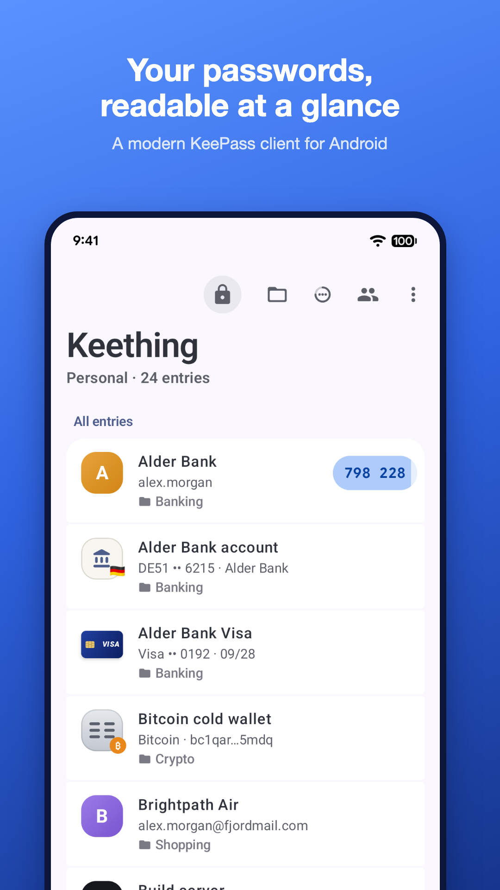
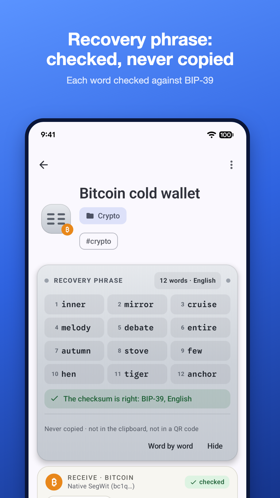
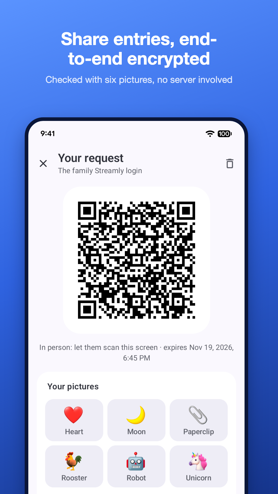

# Keething for Android

**KeePass on Android that looks like it was made this year.**
Your `.kdbx` file, synced your way: Keething follows every change your sync tool delivers and never loses the file.
No account, no network permission, nothing collected. Free and open source.

It is for people who already keep their passwords in KeePass (KeePassXC on the desktop, the file synced by
Syncthing, Nextcloud, a NAS, …) and want an Android client that is pleasant to use.

  
  
  

## What it does

- Opens your KeePass databases from any folder you choose, several side by side, and follows the file when your sync
  tool replaces it; a conflict copy is noticed and can be resolved on the phone.
- Fingerprint unlock after the first time you type the master password; key files too.
- Search as you type, also by group (`@group`) and tag (`#tag`).
- Readable entry cards: custom fields laid out, one-time codes live with their countdown, attachments, the history of
  an entry and a way back to an earlier version.
- Entries made for what they hold: a payment card drawn as a card, a Wi-Fi network, a bank account by its IBAN, an
  identity document, an SSH login. A crypto wallet's recovery phrase is checked word by word as you look at it and is
  never copied (no copy button, no QR code, no share); its address comes with its network and a QR code to receive.
- Editing and creating entries and databases, adding one-time codes (typed, pasted or from a QR code), attachments,
  changing a database's master key, backups you can see and restore.
- Autofill in apps and browsers, with Android's "save this password?" offer.
- A password generator, and an entry shared with another phone through a QR code.
- Copied values are marked sensitive and cleared from the clipboard after 30 seconds.

KDBX 4 (AES-256 or ChaCha20, Argon2 or AES-KDF). A KDBX 3.1 database (KeePassDX makes new ones so) is shown, and
changed once you agree to upgrade it to KDBX 4; the 3.1 file is kept beside it. Not supported yet: Twofish and
hardware keys (YubiKey); the app says so plainly when it meets one.

Android 14 or later.

## Install

The signed APK is on this repository's [Releases](../../releases). IzzyOnDroid and F-Droid will carry the same APK,
with the same signature, once they list it. The signing certificate's SHA-256:

    80:00:3D:F0:54:33:D0:51:FD:61:C6:74:FF:C2:9A:CD:40:15:9C:07:6A:49:3D:67:D6:99:4E:3C:00:CC:4E:8D

The build is reproducible: the same commit builds the same APK (DEVELOPMENT.md, "Reproducing a release").

## Privacy and security

The app has no network permission: nothing leaves the phone except what you copy, share or autofill yourself. See
[PRIVACY.md](PRIVACY.md). To report a vulnerability, please do not open an issue: see [SECURITY.md](SECURITY.md).

## Building and contributing

[SPEC.md](SPEC.md) says what the app does, screen by screen. [DEVELOPMENT.md](DEVELOPMENT.md) says how to build, test
and install it; it is written for the maintainer's Mac but the commands are ordinary Gradle ones. Before a pull
request, please read [CONTRIBUTING.md](CONTRIBUTING.md).

## Licence

GPL-3.0-or-later ([LICENSE](LICENSE)). The third-party parts keep their own licences, listed in the app's About.
